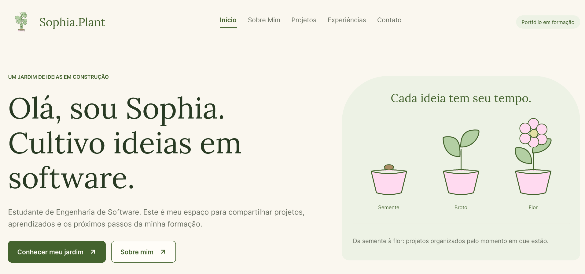
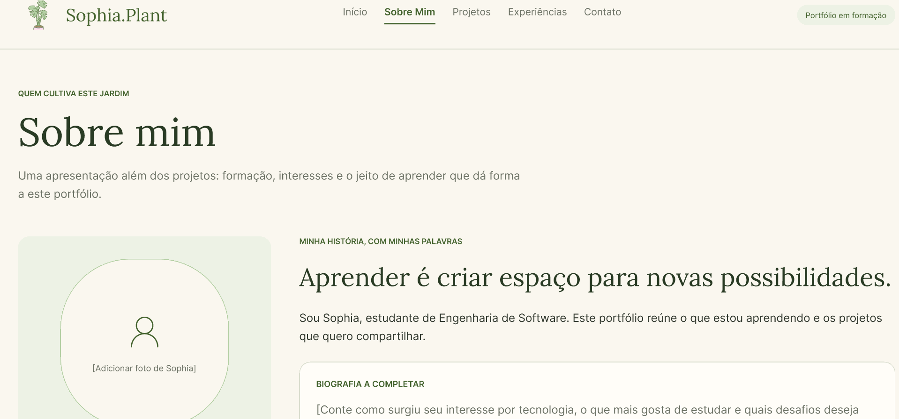
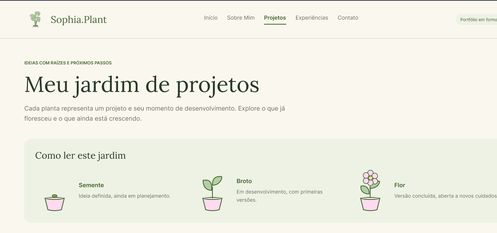
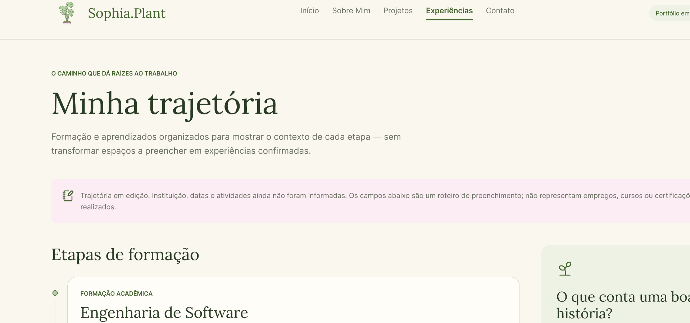
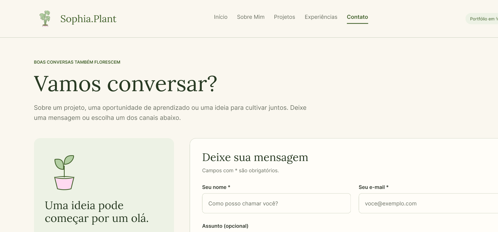
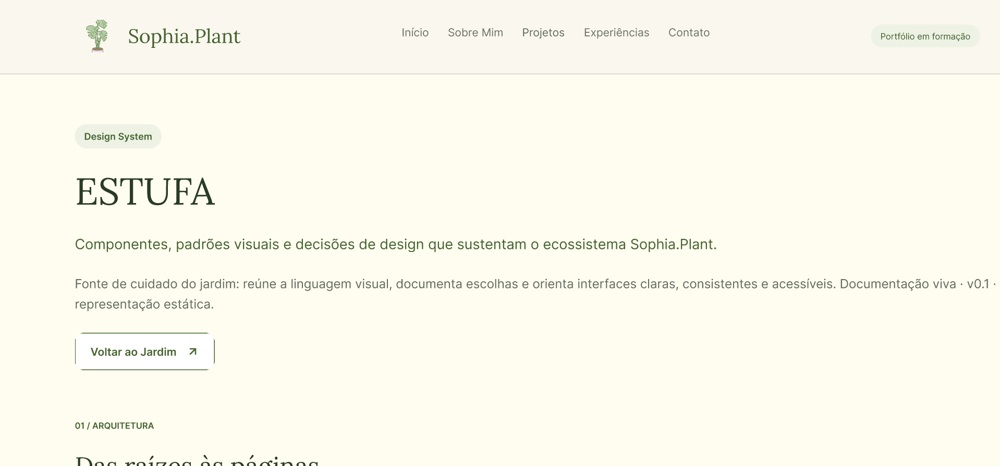

# 🌱 Sophia.Plant — Portfólio Profissional

> Portfólio de Sophia Ferreira, estudante de Engenharia de Software (PUC Minas), em formato de jardim: cada projeto é uma planta, e seu estágio de crescimento mostra a maturidade do projeto.

🔗 **Site publicado:** https://sophia-plant.vercel.app
🎨 **Protótipo no Figma:** https://www.figma.com/design/ddGSWzLxz1WgEAg8ZAp6Us/PORTFOLIO?node-id=0-1&t=re39w3velLurJHMq-1


## 📌 Sobre o projeto

Website de portfólio profissional desenvolvido para a disciplina **DIAW (Desenvolvimento e Integração de Aplicações Web)**, curso de Engenharia de Software da PUC Minas. O site apresenta minha trajetória, projetos, experiências e formas de contato, com versões em **português e inglês**.

### Seções

| Seção | O que apresenta |
|||
| **Início** | Logo e chamada principal |
| **Sobre Mim** | Apresentação (formação, área de atuação, interesses e objetivos), em PT/EN |
| **Projetos** | Jardim/timeline do mais antigo ao mais recente, com nome, descrição, tecnologias, link do GitHub e imagem |
| **Experiências** | Experiências profissionais e certificados: instituição, atividade, período e descrição |
| **Contato** | Ícones clicáveis, formulário com envio por e-mail e jardim de visitantes |
| **Estufa** | Design System da aplicação, com decisões de formatos, cores e fontes |

### Maturidade dos projetos

| Estágio | Significado |
|||
| 🌰 Semente | Ideia definida, ainda em planejamento. |
| 🌱 Broto | Em desenvolvimento, com primeiras versões. |
| 🌸 Flor | Versão concluída, aberta a novos cuidados. |


## 🖼️ Protótipos

> Wireframes de média fidelidade feitos no Figma.

| Tela | Wireframe |
|||
| Início |  |
| Sobre Mim |  |
| Projetos |  |
| Experiências |  |
| Contato |  |
| Design System |  |


## 🛠️ Tecnologias utilizadas

- **React** + **Vite**: interface e ambiente de desenvolvimento
- **React Router**: navegação entre páginas
- **Tailwind CSS**: estilização e responsividade
- **EmailJS**: envio do formulário de contato por e-mail
- **Vercel**: hospedagem
- **Figma**: wireframes
- **Git/GitHub**: versionamento

## 📦 Dependências

```
"dependencies": {
    "@emailjs/browser": "^5.0.3",
    "@tailwindcss/vite": "^4.3.3",
    "react": "^19.2.8",
    "react-dom": "^19.2.8",
    "react-router-dom": "^7.18.4",
    "tailwindcss": "^4.3.3"
  },
  "devDependencies": {
    "@babel/core": "^7.29.7",
    "@eslint/js": "^10.0.1",
    "@rolldown/plugin-babel": "^0.2.3",
    "@testing-library/jest-dom": "^7.0.1",
    "@testing-library/react": "^16.3.3",
    "@types/react": "^19.2.18",
    "@types/react-dom": "^19.2.7",
    "@vitejs/plugin-react": "^6.1.1",
    "babel-plugin-react-compiler": "^1.0.0",
    "eslint": "^10.10.0",
    "eslint-plugin-react-hooks": "^7.1.1",
    "eslint-plugin-react-refresh": "^0.5.6",
    "globals": "^17.12.0",
    "jsdom": "^30.1.2",
    "vite": "^8.3.0",
    "vitest": "^5.0.4"
  }
```


## 📁 Estrutura de diretórios

```
sophia-plant/
├── public/
│   ├── projects/          # imagens e GIFs dos projetos
│   ├── certificates/      # certificados
│   ├── certificate-previews/
│   └── favicon.svg, og-image.png ...
├── src/
│   ├── assets/            # logo e ilustrações das plantas (seed, sprout, flower)
│   ├── components/        # componentes reutilizáveis (ui/, ProjectPreview ...)
│   ├── data/              # projects.json, projects.js, maturity.js, certificates.js
│   ├── i18n/              # traduções PT/EN e hook useLanguage
│   ├── layouts/           # cabeçalho, rodapé e área de conteúdo
│   ├── pages/             # Home, About, Projects, ProjectCard, ProjectDetails,
│   │                      # Experiences, Contact, Greenhouse
│   └── routes/            # definição das rotas
├── index.html
├── package.json
└── vite.config.js
```


## 🚀 Como executar localmente

**Pré-requisitos:** [Node.js](https://nodejs.org/) 18+ e npm.

```bash
# 1. Clone o repositório
git clone [URL DO SEU REPOSITÓRIO]
cd sophia-plant

# 2. Instale as dependências
npm install

# 3. Configure as variáveis de ambiente (veja abaixo)
cp .env.example .env

# 4. Inicie o servidor de desenvolvimento
npm run dev
```

Acesse `http://localhost:5173`.

### Variáveis de ambiente

```env
VITE_EMAILJS_SERVICE_ID=service_03g6ovl
VITE_EMAILJS_TEMPLATE_ID=template_p4wz7on
VITE_EMAILJS_PUBLIC_KEY=0ZHCwBtAV2kJn6g2Y
```

### Outros comandos

```bash
npm run build    # gera a versão de produção em dist/
npm run preview  # visualiza a build localmente
npm run lint     #Realiza a conferência do código
```


## ☁️ Deploy

Hospedado na **Vercel**, com deploy automático a cada push na branch `main`. Variáveis de ambiente configuradas no painel da Vercel.


## ➕ Como adicionar um projeto

1. Coloque a imagem/GIF em `public/projects/`.
2. Adicione o projeto em `src/data/projects.json` (id, nome e descrição em PT/EN, tecnologias, GitHub, maturidade e data).
3. Associe as imagens ao `id` em `src/data/projects.js`.


## 👩‍💻 Autora

**Sophia Ferreira** — Estudante de Engenharia de Software, PUC Minas
[LinkedIn](linkedin.com/in/sophia-ferreira-35019a3b7) · [GitHub](github.com/sophiaferreira1) · [E-mail](sophianfrg@gmail.com)

